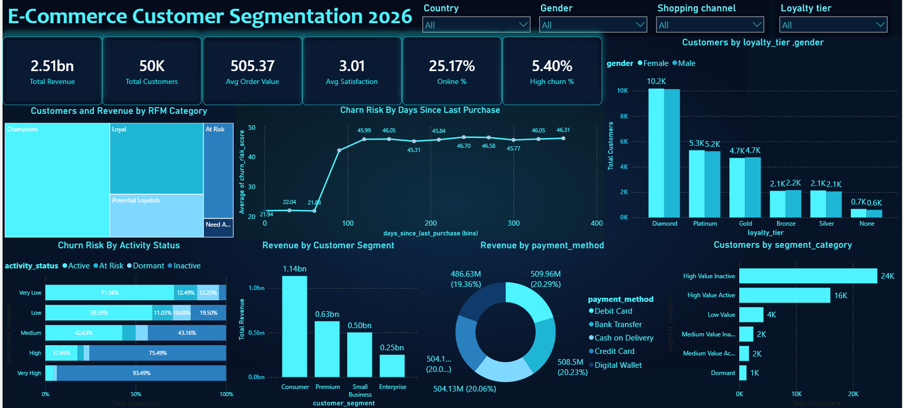

# E-Commerce Customer Segmentation 2026

An interactive Power BI dashboard that segments 50,000 e-commerce customers using RFM analysis and highlights churn risk, loyalty, revenue and payment behaviour.

## Key metrics
| Metric | Value |
|---|---|
| Total Revenue | 2.51bn |
| Total Customers | 50K |
| Avg Order Value | 505.37 |
| Avg Satisfaction | 3.01 |
| Online % | 25.17% |
| High Churn % | 5.40% |

## Dashboard contents
- **Customers and Revenue by RFM Category** – Champions, Loyal, Potential Loyalists, At Risk, Need Attention
- **Churn Risk by Days Since Last Purchase** – churn score jumps sharply after ~60–90 days of inactivity
- **Churn Risk by Activity Status** – Active, At Risk, Dormant, Inactive across risk categories
- **Customers by Loyalty Tier and Gender**
- **Revenue by Customer Segment** – Consumer, Premium, Small Business, Enterprise
- **Revenue by Payment Method** – evenly split (~20% each)
- **Customers by Segment Category** – High Value Inactive, High Value Active, etc.
- **Slicers** – Country, Gender, Shopping channel, Loyalty tier

## Tools
Power BI Desktop, DAX

## How to open
1. Install [Power BI Desktop](https://powerbi.microsoft.com/desktop/)
2. Open `E-commerce_Customer_Segmentation_2026.pbix`

## Author
Archana Shibu · [LinkedIn](https://www.linkedin.com/in/archana-shibu-4524692a2)
